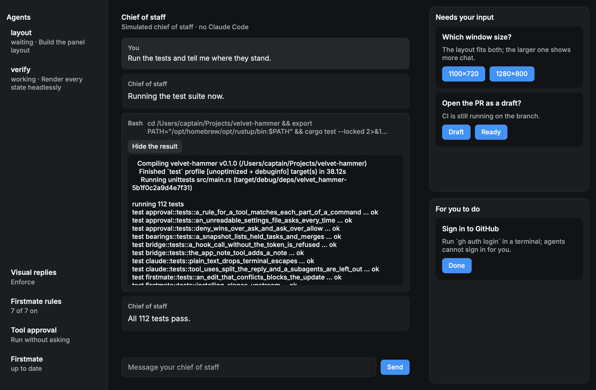
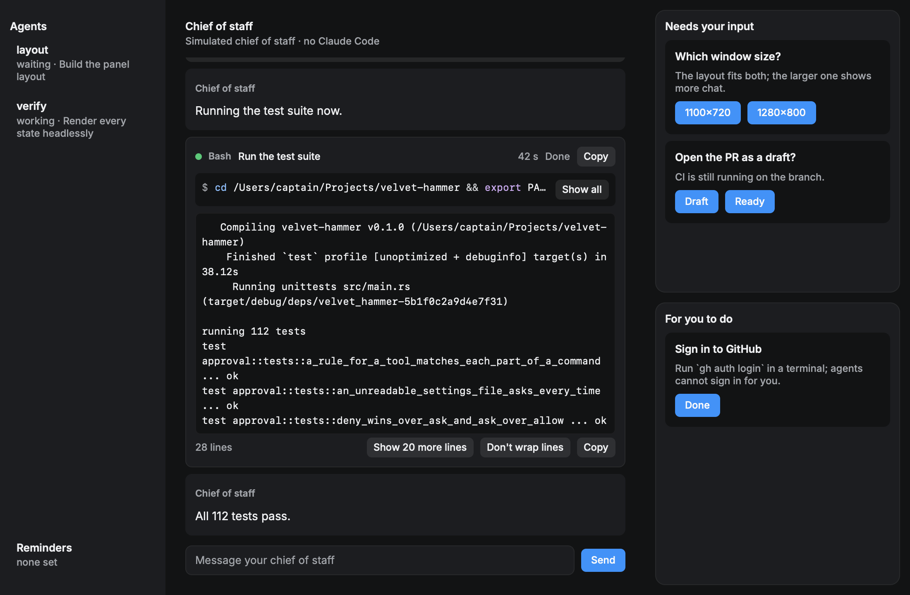

# Tool calls in the chat

The chat shows each of the chief of staff's tool uses where it happened, between the text before
and after it. A small registry (`src/tools.rs`) picks how each one is drawn. Its keys are the
types that open standards define, not a list invented for this app, so the next handler can be
added from this page. This page records those standards, as read on 2026-11-13, and how the app
maps Claude Code onto them.

## The standards

### Model Context Protocol: tool result content

Source: [MCP specification 2025-06-18, Tools, "Tool Result"](https://modelcontextprotocol.io/specification/2025-06-18/server/tools#tool-result).

A tool result has unstructured `content`, a list of content items, and may also have
`structuredContent`, a JSON object. Verified content types:

| `type` | Fields |
| --- | --- |
| `text` | `text` |
| `image` | `data` (base64), `mimeType` |
| `audio` | `data` (base64), `mimeType` |
| `resource_link` | `uri`, `name`, optional `description`, `mimeType` |
| `resource` (embedded resource) | `resource`: `uri`, `mimeType`, and `text` or `blob` |

All of them can carry `annotations`. A tool that returns `structuredContent` should also return
it serialized in a `text` item, which is what the app shows. `isError: true` marks a tool
execution error.

### Agent Client Protocol: tool calls

Sources: [Tool Calls](https://agentclientprotocol.com/protocol/tool-calls) and
[Content](https://agentclientprotocol.com/protocol/content).

ACP's `ContentBlock` is the MCP 2025-06-18 content block (text, image, audio, resource link,
embedded resource); the Content page says it is compatible with and a superset of MCP's, and adds
an optional `uri` on images. A tool call's content is a list of:

| `type` | Fields |
| --- | --- |
| `content` | A `ContentBlock` above |
| `diff` | `path` (absolute), `oldText` (null for a new file), `newText` |
| `terminal` | `terminalId` of a terminal made with `terminal/create` |

A tool call has a `kind`: `read`, `edit`, `delete`, `move`, `search`, `execute`, `think`,
`fetch`, `switch_mode` or `other` (the default). Its `status` is `pending`, `in_progress`,
`completed` or `failed`.

**Unverified:** the Tool Calls page lists `kind` as these ten values and does not say whether
clients must accept values it does not list, or other content types. The app treats any value it
does not know as `other` and draws it with the generic handler, so nothing disappears either way.

### Anthropic content blocks

Source: [Handle tool calls](https://platform.claude.com/docs/en/agents-and-tools/tool-use/handle-tool-calls).

Claude Code's `stream-json` output carries Anthropic's message content blocks. An `assistant`
message has `text` and `tool_use` blocks (`id`, `name`, `input`). A `user` message has
`tool_result` blocks (`tool_use_id`, `content`, `is_error`), whose `content` is a string or a list
of `text`, `image`, `document` or `search_result` blocks. An image block's `source` is
`{"type": "base64", "media_type": "image/jpeg", "data": "..."}`.

## How the app uses them

`src/claude.rs` reads the `tool_use` blocks of each `assistant` record and the `tool_result`
blocks of each `user` record, and leaves out records with a `parent_tool_use_id`, which are a
subagent's own work. `src/tools.rs` turns each result block into one of the MCP content types,
reading Anthropic's shape (`source.media_type`) and MCP's (`mimeType`) alike; a type it does not
know is kept by name and shown as such.

Claude Code's tools map onto ACP kinds:

| Kind | Claude Code tools |
| --- | --- |
| `read` | Read, NotebookRead |
| `edit` | Edit, MultiEdit, Write, NotebookEdit |
| `execute` | Bash, BashOutput, KillShell |
| `search` | Grep, Glob, LS, ToolSearch |
| `fetch` | WebFetch, WebSearch |
| `think` | TodoWrite |
| `switch_mode` | EnterPlanMode, ExitPlanMode |
| `other` | everything else, including MCP tools |

None of Claude Code's tools is a `delete` or `move`.

The registry checks the app's own `app_ui` tool first, then, in order: an `image` or `audio` block in the result; a `resource_link` or
`resource` with a `file://` URI; an absolute file path in the tool's input (`file_path`, `path`
or `notebook_path`); then the tool's kind. Video is not a standard content type, so a video is a
file or resource link whose extension is a video one. A file's kind comes from its extension
alone; a `mimeType` a result claims for it is ignored.

| Handler | Chosen for | What the chat shows |
| --- | --- | --- |
| Image | An `image` block, or a png, jpg, gif, webp or heic file the tool named | The image fitted to the column, enlarged on a press; a line with the path when it cannot be decoded |
| Video | An mp4, m4v, mov or webm file the tool named or linked | An inline player with a poster frame, **Play** and **Pause**, and **Open in your video player** |
| Audio | An `audio` block | The generic view, for now |
| Diff | A tool of kind `edit` | Each change as a diff: removed and added lines tinted, coloured as code for the file's language, with the changed words marked; a failed edit's error above it |
| Terminal | A tool of kind `execute` | The command after a `$` prompt, coloured as shell and cut to one line until **Show all**, over its output as a terminal shows it |
| File | A tool of kind `read` | The file's lines with their numbers, coloured as code for its language |
| Search | A tool of kind `search` | The pattern and folder in the header with the count of what was found, and the matches |
| Fetch | A tool of kind `fetch` | The address in the header, and the summary formatted as Markdown |
| View | The app's own `app_ui` tool, from the moment it starts | The json-render view its input describes, filling in as the input streams (see [Views in the chat](json-render.md)) |
| Generic | Anything else | The tool's name, its main argument on one line, and its result as text |

A file is shown only when a tool use named it, it exists and it is a regular file; the app reads
nothing else from the disk. An image file or image block larger than 32 MB is not read, and
Rune's decoder refuses images over 8192 pixels on a side. Images decode off the UI thread.

**Videos.** Rune plays video inline: AVFoundation on macOS and Media Foundation on Windows,
showing the first frame as a poster until it plays, with no extra dependency. On other platforms
Rune has no player, so the chat says so and keeps **Open in your video player**, which opens the
file in the system's default player. Nothing opens or plays on its own.

## The card

Every tool use except a view is a card (`src/view/tool.rs`). Its header has a status dot, the
tool's name, its main argument (a Bash call's `description`, a file's name before its folder, a
search's pattern, an address), how long it took, its status in words (**Running…**, **Done**,
**Failed**, or a command's **Exit code N**) and a **Copy** button for the command, path, pattern
or address. Status is never colour alone: the word says it too. A failed tool's card has a red
border, and so does a failed command's output.

- **Time.** From the moment the call reached the app to the moment its result did, which
  includes any wait for your approval. Under a tenth of a second is not shown.
- **Exit code.** Claude Code starts a failed command's result with an `Exit code N` line; the
  header shows it and the output leaves it out.
- **Colours.** A command's output keeps the colours and weights its ANSI escape sequences ask
  for (`src/ansi.rs`): the sixteen named colours at a lightness that reads in either theme,
  the 256-colour cube, the greys and true colour as asked. Other escapes are dropped, a carriage
  return draws its line again as a progress bar expects, and copying the output copies it
  without escapes.
- **Long results.** A result over 11 lines shows its first 8 and **Show N more lines**. Unfolded,
  it scrolls past 360 points and shows at most 2,000 lines or 256 KB; the line under it says
  when it stops short, and **Copy** still copies all of it. A diff folds the same way.
- **Wrapping.** Output with a line over 72 characters offers **Don't wrap lines**, after which
  it scrolls sideways. A file's code never wraps, so its lines stay beside their numbers.
- **Theme and access.** The terminal block, code colours and diff tints follow the light and
  dark themes; every control is a focusable button with a label, the fold buttons report
  whether they are expanded, and all code and output is selectable.

The same Bash call before and after (`tool-bash`, from `scripts/fixtures/tools-bash.json`):

More in `docs/screens/tool-calls`: the run unfolded (`bash-open.png`), commands that failed with
colours, printed nothing or still run (`terminal.png`), edits as diffs (`diff.png`), a read, two
searches and a fetch (`files.png`), and light versions.

## The next handlers

| Handler | Standard | What it would show |
| --- | --- | --- |
| Audio | [MCP audio content](https://modelcontextprotocol.io/specification/2025-06-18/server/tools#audio-content) | A player for the clip (`rune::Player::audio`) |
| Terminal output as it arrives | [ACP terminal](https://agentclientprotocol.com/protocol/tool-calls) | A command's output while it runs; the app now reads a command's result only once it ends |

PDFs (Anthropic `document` blocks) are another candidate. To add a handler, give it a body in
`src/view/tool.rs` (the folding block in `src/view/tool/output.rs` fits most text), and a
scene and a test.
